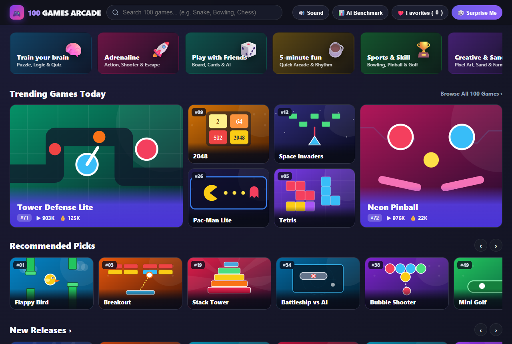
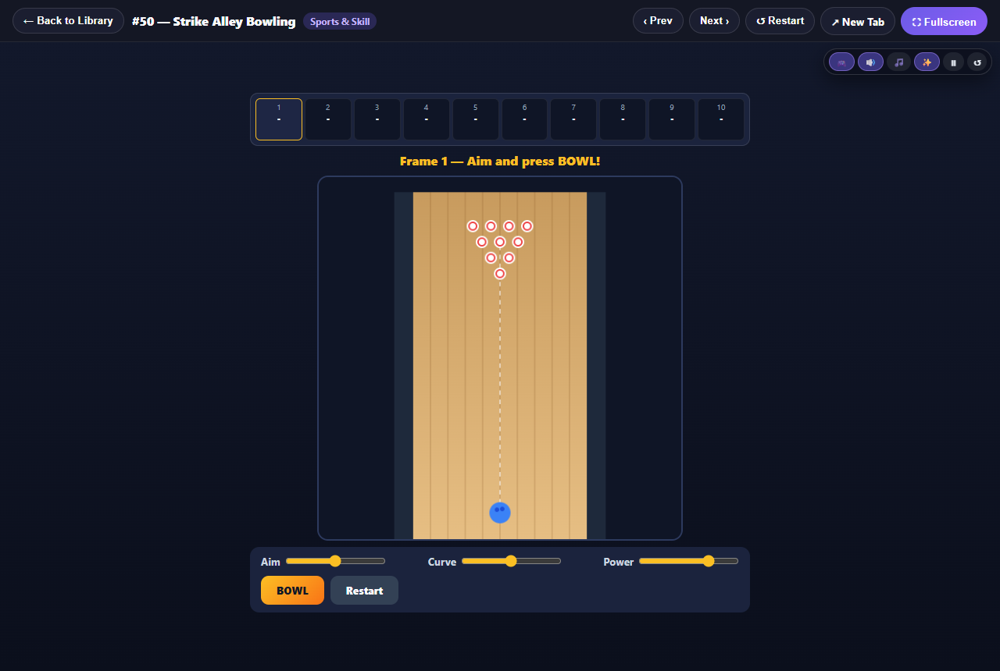

<div align="center">

# 🎮 100 Games Arcade

**100 playable single-file HTML5 web games unified in an instant-play dark arcade portal — zero build tools, zero external runtime dependencies, and a drop-in AAA audio/FX enhancement layer.**

[](https://nnoppons.github.io/100-games/)
[](https://nnoppons.github.io/100-games/)
[](./AI_EXPERIMENT_REPORT.md)
[](./LICENSE)

[🕹️ **Launch Arcade Portal**](https://nnoppons.github.io/100-games/) · [📊 **Read AI Multi-Agent Report**](./AI_EXPERIMENT_REPORT.md) · [🎲 **Play Random Game**](https://nnoppons.github.io/100-games/#play=71-tower-defense)

</div>

---

## ✨ Preview

<p align="center">
  
</p>

<details>
<summary>📸 In-Portal Game Player View</summary>
<p align="center">
  
</p>
</details>

---

## 🚀 Key Features

- **100 Distinct Playable Games (`01`–`100`):** Spanning Arcade Classics, Brain & Logic Puzzles, Strategy & AI Board Games, Action Shooters, Sports & Physics, and Creative Sandboxes.
- **AAA Arcade Enhancement Layer ([`assets/aaa-arcade.js`](./assets/aaa-arcade.js)):**
  - **Procedural WebAudio Synthesizer:** Automatic retro-modern SFX on interactions, ascending combo chimes on score increases, win/game-over stingers, plus a toggleable ambient chiptune BGM loop.
  - **Particle & Combo FX Canvas:** 60fps pointer/score particle bursts, floating `+Points / COMBO xN!` popups, and micro screen-shake.
  - **Shadow-DOM Floating HUD:** Isolated pause curtain (`P`), sound/music/FX toggles, instant restart, and return-to-library control with zero CSS interference.
- **Instant Dark Arcade Portal ([`index.html`](./index.html)):**
  - Curated category gradient strip, Trending Bento showcase, Recently Played shelf, search bar, sort controls (`#01–#100`, `Most Popular`, `A–Z`), Favorites persistence (`localStorage`), and hash deep-linking (`#play=<folder>`).
  - Procedural SVG cover art generator ([`assets/art.js`](./assets/art.js)) rendering crisp vector thumbnails with zero external image requests.
- **100% Static & Portable:** Works identically on GitHub Pages, any static web host, or opened locally.

---

## 🧪 AI Multi-Agent Experiment

This repository doubles as a **real-world benchmark of multi-agent AI code generation**, orchestrated across multiple models and concurrency strategies:

| Metric | Value |
|---|---|
| Total Playable Games | **100 / 100** |
| Total Lines of Code | **42,117 lines** (avg. 421 lines/game) |
| Total Code Size (HTML/CSS/JS) | **1.37 MB** (avg. 14.0 KB/game) |
| Rendering Engines | **60 Canvas** · **38 DOM/CSS** · **2 SVG** |
| Verification Status | **100/100** syntax-checked & swept in headless Edge/Puppeteer (**0 runtime errors**) |

👉 Read the full engineering breakdown, rate-limit scaling telemetry, model code-style comparison (**Devin SWE-2 High** vs **DeepSeek V4.1 Flash** vs **Gemini-4-Hydrogen**), and bug-discovery postmortem in **[AI_EXPERIMENT_REPORT.md](./AI_EXPERIMENT_REPORT.md)**.

---

## 🛠️ Run Locally

No `npm install` or build step required:

```bash
git clone https://github.com/NnopponS/100-games.git
cd 100-games

# Serve with Python, Node, or any static server:
python -m http.server 8080
# or
npx serve .
```

Then open `http://localhost:8080` in your browser.

---

## 📂 Project Structure

```text
100-games/
├── index.html                 # Dark Arcade Library Portal & In-Portal Player
├── assets/
│   ├── games.js               # Catalog metadata for all 100 games
│   ├── art.js                 # Procedural SVG cover artwork engine
│   └── aaa-arcade.js          # Shared AAA WebAudio, Particle FX & Pause HUD layer
├── docs/                      # Portal & player screenshots
├── 01-flappy-bird/index.html  # Self-contained game #01
├── ...
├── 100-worm-game/index.html   # Self-contained game #100
├── AI_EXPERIMENT_REPORT.md    # Detailed multi-agent benchmark & analysis
├── CONTRIBUTING.md
└── LICENSE
```

---

## 🕹️ Complete 100 Games Directory

### Train your brain (Puzzle, Logic & Quiz) (27)

| # | Game | Engine | Play Live | Source |
|---:|------|--------|-----------|--------|
| 05 | **Tetris** | Canvas | [Play ▶](https://nnoppons.github.io/100-games/#play=05-tetris) | [`05-tetris`](./05-tetris/index.html) |
| 06 | **Memory Match** | DOM | [Play ▶](https://nnoppons.github.io/100-games/#play=06-memory-match) | [`06-memory-match`](./06-memory-match/index.html) |
| 08 | **Minesweeper** | DOM | [Play ▶](https://nnoppons.github.io/100-games/#play=08-minesweeper) | [`08-minesweeper`](./08-minesweeper/index.html) |
| 09 | **2048** | DOM | [Play ▶](https://nnoppons.github.io/100-games/#play=09-2048) | [`09-2048`](./09-2048/index.html) |
| 11 | **Simon Says** | DOM | [Play ▶](https://nnoppons.github.io/100-games/#play=11-simon-says) | [`11-simon-says`](./11-simon-says/index.html) |
| 22 | **Hangman** | Canvas | [Play ▶](https://nnoppons.github.io/100-games/#play=22-hangman) | [`22-hangman`](./22-hangman/index.html) |
| 23 | **Wordle Clone** | DOM | [Play ▶](https://nnoppons.github.io/100-games/#play=23-wordle-clone) | [`23-wordle-clone`](./23-wordle-clone/index.html) |
| 25 | **Maze Runner** | Canvas | [Play ▶](https://nnoppons.github.io/100-games/#play=25-maze-runner) | [`25-maze-runner`](./25-maze-runner/index.html) |
| 29 | **Guess the Number** | DOM | [Play ▶](https://nnoppons.github.io/100-games/#play=29-guess-number) | [`29-guess-number`](./29-guess-number/index.html) |
| 31 | **15 Sliding Puzzle** | DOM | [Play ▶](https://nnoppons.github.io/100-games/#play=31-sliding-puzzle) | [`31-sliding-puzzle`](./31-sliding-puzzle/index.html) |
| 32 | **Lights Out** | DOM | [Play ▶](https://nnoppons.github.io/100-games/#play=32-lights-out) | [`32-lights-out`](./32-lights-out/index.html) |
| 33 | **Sudoku** | DOM | [Play ▶](https://nnoppons.github.io/100-games/#play=33-sudoku) | [`33-sudoku`](./33-sudoku/index.html) |
| 60 | **Math Sprint** | DOM | [Play ▶](https://nnoppons.github.io/100-games/#play=60-math-sprint) | [`60-math-sprint`](./60-math-sprint/index.html) |
| 61 | **Word Scramble** | DOM | [Play ▶](https://nnoppons.github.io/100-games/#play=61-word-scramble) | [`61-word-scramble`](./61-word-scramble/index.html) |
| 62 | **Flags Quiz** | SVG | [Play ▶](https://nnoppons.github.io/100-games/#play=62-flags-quiz) | [`62-flags-quiz`](./62-flags-quiz/index.html) |
| 63 | **Knight's Tour** | DOM | [Play ▶](https://nnoppons.github.io/100-games/#play=63-knight-tour) | [`63-knight-tour`](./63-knight-tour/index.html) |
| 64 | **Pipe Connect** | DOM | [Play ▶](https://nnoppons.github.io/100-games/#play=64-pipe-connect) | [`64-pipe-connect`](./64-pipe-connect/index.html) |
| 65 | **Color Flood** | DOM | [Play ▶](https://nnoppons.github.io/100-games/#play=65-color-flood) | [`65-color-flood`](./65-color-flood/index.html) |
| 75 | **Train Switcher** | Canvas | [Play ▶](https://nnoppons.github.io/100-games/#play=75-train-switcher) | [`75-train-switcher`](./75-train-switcher/index.html) |
| 78 | **World Capitals Quiz** | DOM | [Play ▶](https://nnoppons.github.io/100-games/#play=78-capitals-quiz) | [`78-capitals-quiz`](./78-capitals-quiz/index.html) |
| 79 | **Tangram Puzzle** | Canvas | [Play ▶](https://nnoppons.github.io/100-games/#play=79-tangram) | [`79-tangram`](./79-tangram/index.html) |
| 80 | **Jigsaw Lite** | Canvas | [Play ▶](https://nnoppons.github.io/100-games/#play=80-jigsaw) | [`80-jigsaw`](./80-jigsaw/index.html) |
| 83 | **Shadow Guess** | SVG | [Play ▶](https://nnoppons.github.io/100-games/#play=83-shadow-guess) | [`83-shadow-guess`](./83-shadow-guess/index.html) |
| 84 | **Emoji Match** | DOM | [Play ▶](https://nnoppons.github.io/100-games/#play=84-emoji-match) | [`84-emoji-match`](./84-emoji-match/index.html) |
| 88 | **Snake Maze** | Canvas | [Play ▶](https://nnoppons.github.io/100-games/#play=88-snake-maze) | [`88-snake-maze`](./88-snake-maze/index.html) |
| 95 | **Laser Reflect** | Canvas | [Play ▶](https://nnoppons.github.io/100-games/#play=95-laser-reflect) | [`95-laser-reflect`](./95-laser-reflect/index.html) |
| 97 | **Math Blocks** | DOM | [Play ▶](https://nnoppons.github.io/100-games/#play=97-math-blocks) | [`97-math-blocks`](./97-math-blocks/index.html) |

### Adrenaline (Action, Shooter & Escape) (18)

| # | Game | Engine | Play Live | Source |
|---:|------|--------|-----------|--------|
| 12 | **Space Invaders** | Canvas | [Play ▶](https://nnoppons.github.io/100-games/#play=12-space-invaders) | [`12-space-invaders`](./12-space-invaders/index.html) |
| 13 | **Asteroids** | Canvas | [Play ▶](https://nnoppons.github.io/100-games/#play=13-asteroids) | [`13-asteroids`](./13-asteroids/index.html) |
| 15 | **Doodle Jump** | Canvas | [Play ▶](https://nnoppons.github.io/100-games/#play=15-doodle-jump) | [`15-doodle-jump`](./15-doodle-jump/index.html) |
| 16 | **Missile Command** | Canvas | [Play ▶](https://nnoppons.github.io/100-games/#play=16-missile-command) | [`16-missile-command`](./16-missile-command/index.html) |
| 18 | **Helicopter Cave Flyer** | Canvas | [Play ▶](https://nnoppons.github.io/100-games/#play=18-helicopter) | [`18-helicopter`](./18-helicopter/index.html) |
| 41 | **Dodger** | Canvas | [Play ▶](https://nnoppons.github.io/100-games/#play=41-dodger) | [`41-dodger`](./41-dodger/index.html) |
| 42 | **Endless Runner** | Canvas | [Play ▶](https://nnoppons.github.io/100-games/#play=42-endless-runner) | [`42-endless-runner`](./42-endless-runner/index.html) |
| 52 | **Car Dodger** | Canvas | [Play ▶](https://nnoppons.github.io/100-games/#play=52-car-dodger) | [`52-car-dodger`](./52-car-dodger/index.html) |
| 53 | **Crossy Road** | Canvas | [Play ▶](https://nnoppons.github.io/100-games/#play=53-crossy-road) | [`53-crossy-road`](./53-crossy-road/index.html) |
| 54 | **Submarine** | Canvas | [Play ▶](https://nnoppons.github.io/100-games/#play=54-submarine) | [`54-submarine`](./54-submarine/index.html) |
| 67 | **Gravity Flip Runner** | Canvas | [Play ▶](https://nnoppons.github.io/100-games/#play=67-gravity-flip) | [`67-gravity-flip`](./67-gravity-flip/index.html) |
| 81 | **Orbit Dodge** | Canvas | [Play ▶](https://nnoppons.github.io/100-games/#play=81-orbit-dodge) | [`81-orbit-dodge`](./81-orbit-dodge/index.html) |
| 82 | **Rocket Escape** | Canvas | [Play ▶](https://nnoppons.github.io/100-games/#play=82-rocket-escape) | [`82-rocket-escape`](./82-rocket-escape/index.html) |
| 91 | **Volcano Escape** | Canvas | [Play ▶](https://nnoppons.github.io/100-games/#play=91-volcano-escape) | [`91-volcano-escape`](./91-volcano-escape/index.html) |
| 92 | **Treasure Dive** | Canvas | [Play ▶](https://nnoppons.github.io/100-games/#play=92-treasure-dive) | [`92-treasure-dive`](./92-treasure-dive/index.html) |
| 94 | **Ghost Catch** | Canvas | [Play ▶](https://nnoppons.github.io/100-games/#play=94-ghost-catch) | [`94-ghost-catch`](./94-ghost-catch/index.html) |
| 98 | **Planet Defender** | Canvas | [Play ▶](https://nnoppons.github.io/100-games/#play=98-planet-defender) | [`98-planet-defender`](./98-planet-defender/index.html) |
| 99 | **Kite Flyer** | Canvas | [Play ▶](https://nnoppons.github.io/100-games/#play=99-kite-flyer) | [`99-kite-flyer`](./99-kite-flyer/index.html) |

### Play with Friends (Board, Cards & AI) (15)

| # | Game | Engine | Play Live | Source |
|---:|------|--------|-----------|--------|
| 04 | **Pong** | Canvas | [Play ▶](https://nnoppons.github.io/100-games/#play=04-pong) | [`04-pong`](./04-pong/index.html) |
| 10 | **Tic-Tac-Toe vs AI** | DOM | [Play ▶](https://nnoppons.github.io/100-games/#play=10-tic-tac-toe-ai) | [`10-tic-tac-toe-ai`](./10-tic-tac-toe-ai/index.html) |
| 21 | **Connect Four vs AI** | DOM | [Play ▶](https://nnoppons.github.io/100-games/#play=21-connect-four) | [`21-connect-four`](./21-connect-four/index.html) |
| 28 | **Rock Paper Scissors** | DOM | [Play ▶](https://nnoppons.github.io/100-games/#play=28-rock-paper-scissors) | [`28-rock-paper-scissors`](./28-rock-paper-scissors/index.html) |
| 30 | **Blackjack** | DOM | [Play ▶](https://nnoppons.github.io/100-games/#play=30-blackjack) | [`30-blackjack`](./30-blackjack/index.html) |
| 34 | **Battleship vs AI** | DOM | [Play ▶](https://nnoppons.github.io/100-games/#play=34-battleship) | [`34-battleship`](./34-battleship/index.html) |
| 35 | **Reversi** | DOM | [Play ▶](https://nnoppons.github.io/100-games/#play=35-reversi) | [`35-reversi`](./35-reversi/index.html) |
| 36 | **Gomoku** | Canvas | [Play ▶](https://nnoppons.github.io/100-games/#play=36-gomoku) | [`36-gomoku`](./36-gomoku/index.html) |
| 37 | **Checkers vs AI** | DOM | [Play ▶](https://nnoppons.github.io/100-games/#play=37-checkers) | [`37-checkers`](./37-checkers/index.html) |
| 39 | **Air Hockey vs AI** | Canvas | [Play ▶](https://nnoppons.github.io/100-games/#play=39-air-hockey) | [`39-air-hockey`](./39-air-hockey/index.html) |
| 66 | **Chain Reaction** | DOM | [Play ▶](https://nnoppons.github.io/100-games/#play=66-chain-reaction) | [`66-chain-reaction`](./66-chain-reaction/index.html) |
| 71 | **Tower Defense Lite** | Canvas | [Play ▶](https://nnoppons.github.io/100-games/#play=71-tower-defense) | [`71-tower-defense`](./71-tower-defense/index.html) |
| 85 | **Golf Solitaire** | DOM | [Play ▶](https://nnoppons.github.io/100-games/#play=85-solitaire-golf) | [`85-solitaire-golf`](./85-solitaire-golf/index.html) |
| 86 | **Slot Machine** | DOM | [Play ▶](https://nnoppons.github.io/100-games/#play=86-slot-machine) | [`86-slot-machine`](./86-slot-machine/index.html) |
| 87 | **Dice Battle** | DOM | [Play ▶](https://nnoppons.github.io/100-games/#play=87-dice-battle) | [`87-dice-battle`](./87-dice-battle/index.html) |

### 5-minute fun (Classic Arcade & Rhythm) (21)

| # | Game | Engine | Play Live | Source |
|---:|------|--------|-----------|--------|
| 01 | **Flappy Bird** | Canvas | [Play ▶](https://nnoppons.github.io/100-games/#play=01-flappy-bird) | [`01-flappy-bird`](./01-flappy-bird/index.html) |
| 02 | **Snake** | Canvas | [Play ▶](https://nnoppons.github.io/100-games/#play=02-snake) | [`02-snake`](./02-snake/index.html) |
| 03 | **Breakout** | Canvas | [Play ▶](https://nnoppons.github.io/100-games/#play=03-breakout) | [`03-breakout`](./03-breakout/index.html) |
| 07 | **Whack-a-Mole** | DOM | [Play ▶](https://nnoppons.github.io/100-games/#play=07-whack-a-mole) | [`07-whack-a-mole`](./07-whack-a-mole/index.html) |
| 14 | **Frogger** | Canvas | [Play ▶](https://nnoppons.github.io/100-games/#play=14-frogger) | [`14-frogger`](./14-frogger/index.html) |
| 19 | **Stack Tower** | Canvas | [Play ▶](https://nnoppons.github.io/100-games/#play=19-stack-tower) | [`19-stack-tower`](./19-stack-tower/index.html) |
| 20 | **Piano Tiles** | DOM | [Play ▶](https://nnoppons.github.io/100-games/#play=20-piano-tiles) | [`20-piano-tiles`](./20-piano-tiles/index.html) |
| 24 | **Reaction Timer** | DOM | [Play ▶](https://nnoppons.github.io/100-games/#play=24-reaction-timer) | [`24-reaction-timer`](./24-reaction-timer/index.html) |
| 26 | **Pac-Man Lite** | Canvas | [Play ▶](https://nnoppons.github.io/100-games/#play=26-pacman-lite) | [`26-pacman-lite`](./26-pacman-lite/index.html) |
| 27 | **Typing Racer** | DOM | [Play ▶](https://nnoppons.github.io/100-games/#play=27-typing-racer) | [`27-typing-racer`](./27-typing-racer/index.html) |
| 38 | **Bubble Shooter** | Canvas | [Play ▶](https://nnoppons.github.io/100-games/#play=38-bubble-shooter) | [`38-bubble-shooter`](./38-bubble-shooter/index.html) |
| 40 | **Catch Falling Items** | Canvas | [Play ▶](https://nnoppons.github.io/100-games/#play=40-catch-falling) | [`40-catch-falling`](./40-catch-falling/index.html) |
| 55 | **Balloon Pop** | DOM | [Play ▶](https://nnoppons.github.io/100-games/#play=55-balloon-pop) | [`55-balloon-pop`](./55-balloon-pop/index.html) |
| 57 | **Button Masher** | DOM | [Play ▶](https://nnoppons.github.io/100-games/#play=57-button-masher) | [`57-button-masher`](./57-button-masher/index.html) |
| 58 | **Rhythm Tap** | Canvas | [Play ▶](https://nnoppons.github.io/100-games/#play=58-rhythm-tap) | [`58-rhythm-tap`](./58-rhythm-tap/index.html) |
| 59 | **Dance Arrows** | Canvas | [Play ▶](https://nnoppons.github.io/100-games/#play=59-dance-arrows) | [`59-dance-arrows`](./59-dance-arrows/index.html) |
| 89 | **Bounce Ball** | Canvas | [Play ▶](https://nnoppons.github.io/100-games/#play=89-bounce-ball) | [`89-bounce-ball`](./89-bounce-ball/index.html) |
| 90 | **Ice Breaker** | Canvas | [Play ▶](https://nnoppons.github.io/100-games/#play=90-ice-breaker) | [`90-ice-breaker`](./90-ice-breaker/index.html) |
| 93 | **Bug Squash** | Canvas | [Play ▶](https://nnoppons.github.io/100-games/#play=93-bug-squash) | [`93-bug-squash`](./93-bug-squash/index.html) |
| 96 | **Color Match Rush** | DOM | [Play ▶](https://nnoppons.github.io/100-games/#play=96-uno-colors) | [`96-uno-colors`](./96-uno-colors/index.html) |
| 100 | **Wrap-Around Worm** | Canvas | [Play ▶](https://nnoppons.github.io/100-games/#play=100-worm-game) | [`100-worm-game`](./100-worm-game/index.html) |

### Sports & Skill (Aim, Physics & Sports) (12)

| # | Game | Engine | Play Live | Source |
|---:|------|--------|-----------|--------|
| 17 | **Lunar Lander** | Canvas | [Play ▶](https://nnoppons.github.io/100-games/#play=17-lunar-lander) | [`17-lunar-lander`](./17-lunar-lander/index.html) |
| 43 | **Ski Slope** | Canvas | [Play ▶](https://nnoppons.github.io/100-games/#play=43-ski-slope) | [`43-ski-slope`](./43-ski-slope/index.html) |
| 45 | **Target Shooter** | DOM | [Play ▶](https://nnoppons.github.io/100-games/#play=45-target-shooter) | [`45-target-shooter`](./45-target-shooter/index.html) |
| 46 | **Archery** | Canvas | [Play ▶](https://nnoppons.github.io/100-games/#play=46-archery) | [`46-archery`](./46-archery/index.html) |
| 47 | **Basketball Shootout** | Canvas | [Play ▶](https://nnoppons.github.io/100-games/#play=47-basketball) | [`47-basketball`](./47-basketball/index.html) |
| 48 | **Penalty Kicks** | Canvas | [Play ▶](https://nnoppons.github.io/100-games/#play=48-penalty-kicks) | [`48-penalty-kicks`](./48-penalty-kicks/index.html) |
| 49 | **Mini Golf** | Canvas | [Play ▶](https://nnoppons.github.io/100-games/#play=49-mini-golf) | [`49-mini-golf`](./49-mini-golf/index.html) |
| 50 | **Strike Alley Bowling** | Canvas | [Play ▶](https://nnoppons.github.io/100-games/#play=50-bowling) | [`50-bowling`](./50-bowling/index.html) |
| 51 | **Darts** | Canvas | [Play ▶](https://nnoppons.github.io/100-games/#play=51-darts) | [`51-darts`](./51-darts/index.html) |
| 72 | **Neon Pinball** | Canvas | [Play ▶](https://nnoppons.github.io/100-games/#play=72-pinball) | [`72-pinball`](./72-pinball/index.html) |
| 73 | **Ice Curling** | Canvas | [Play ▶](https://nnoppons.github.io/100-games/#play=73-curling) | [`73-curling`](./73-curling/index.html) |
| 74 | **Pool Lite** | Canvas | [Play ▶](https://nnoppons.github.io/100-games/#play=74-pool-lite) | [`74-pool-lite`](./74-pool-lite/index.html) |

### Creative & Sandbox (Art, Sand & Idle) (7)

| # | Game | Engine | Play Live | Source |
|---:|------|--------|-----------|--------|
| 44 | **Fishing Frenzy** | Canvas | [Play ▶](https://nnoppons.github.io/100-games/#play=44-fishing) | [`44-fishing`](./44-fishing/index.html) |
| 56 | **Cookie Clicker** | DOM | [Play ▶](https://nnoppons.github.io/100-games/#play=56-cookie-clicker) | [`56-cookie-clicker`](./56-cookie-clicker/index.html) |
| 68 | **Pixel Painter** | Canvas | [Play ▶](https://nnoppons.github.io/100-games/#play=68-pixel-painter) | [`68-pixel-painter`](./68-pixel-painter/index.html) |
| 69 | **Etch A Sketch** | Canvas | [Play ▶](https://nnoppons.github.io/100-games/#play=69-etch-sketch) | [`69-etch-sketch`](./69-etch-sketch/index.html) |
| 70 | **Falling Sand** | Canvas | [Play ▶](https://nnoppons.github.io/100-games/#play=70-falling-sand) | [`70-falling-sand`](./70-falling-sand/index.html) |
| 76 | **Fireworks** | Canvas | [Play ▶](https://nnoppons.github.io/100-games/#play=76-fireworks) | [`76-fireworks`](./76-fireworks/index.html) |
| 77 | **Farm Clicker** | DOM | [Play ▶](https://nnoppons.github.io/100-games/#play=77-farm-clicker) | [`77-farm-clicker`](./77-farm-clicker/index.html) |


---

## 📄 License

Released under the [MIT License](./LICENSE).
